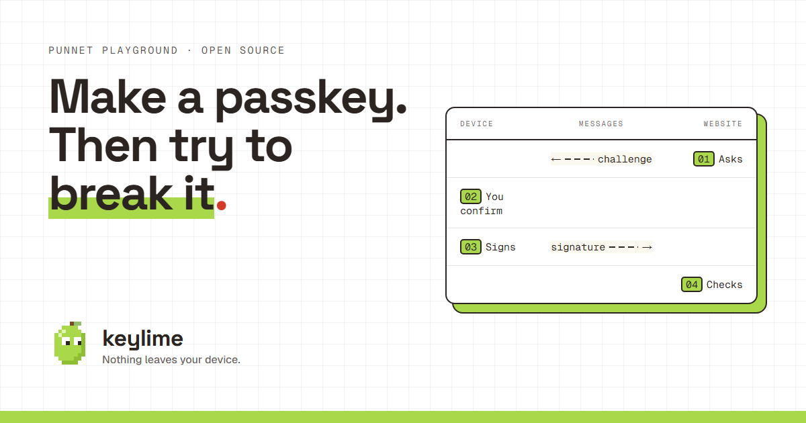
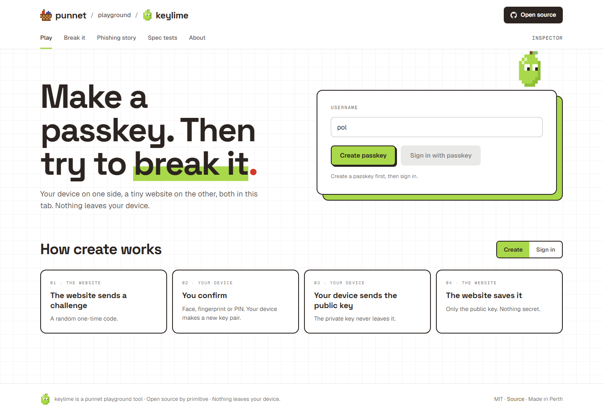
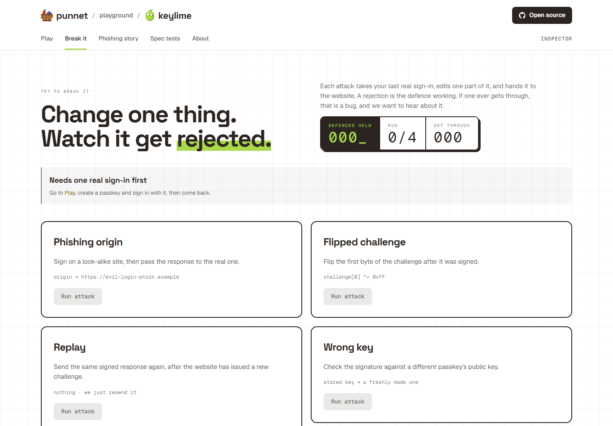
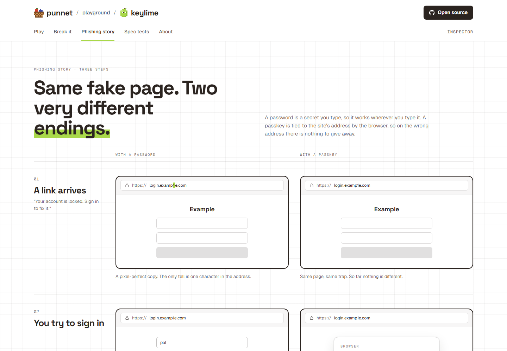
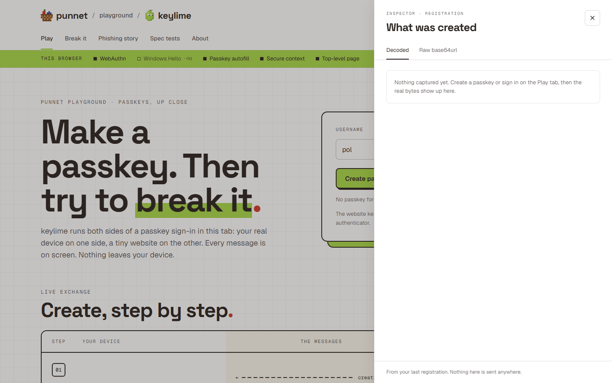

  

<b><a href="https://punnet.dev/playground/keylime/">Play keylime</a></b> · <a href="#nothing-leaves-your-device">Privacy</a> · <a href="#develop">Develop</a> · <a href="https://punnet.dev/playground/">punnet playground</a>

Most passkey explainers stop at "it's more secure". keylime shows the bytes. It runs both sides of a passkey sign-in in one browser tab: your real device on one side, a small website on the other. Every message is on screen, and you can break them on purpose to watch the checks catch it.

Nothing leaves your device.

## What it does

| Play                                                       | Break it                                       | Learn                                                                                         |
| ---------------------------------------------------------- | ---------------------------------------------- | --------------------------------------------------------------------------------------------- |
| Makes a real passkey with `navigator.credentials.create()` | Swaps the origin for a look-alike site         | A phishing story: the same fake page with a password and with a passkey                       |
| Signs in with it using `navigator.credentials.get()`       | Flips a byte of the challenge                  | Spec tests that run in your browser with WebCrypto                                            |
| Shows each step: challenge, confirm, sign, check           | Replays an old sign-in against a new challenge | An inspector with the decoded `clientDataJSON`, `authenticatorData`, public key and signature |
| Lists every check the website ran, pass or fail            | Checks the signature against a different key   |                                                                                               |

  
  

  
  

## Nothing leaves your device

- **No server.** The "website" is a relying party written in TypeScript that runs in the page: random challenges from `crypto.getRandomValues`, a hand-written CBOR decoder, `authenticatorData` parsing, and ES256 and RS256 checks with `crypto.subtle.verify`.
- **Public key only.** The website stores your public key in IndexedDB in this browser. The private key never leaves your authenticator.
- **No network calls after the page loads.** No analytics, no accounts, no remote fonts.
- **Attacks edit a copy.** Your passkey isn't touched.

To remove a test passkey from your device, search for the site's address in Windows Settings → Accounts → Passkeys, the Passwords app on macOS and iOS, or `chrome://password-manager/passwords`.

## Develop

    npm install
    npm run dev      # http://localhost:5173
    npm test
    npm run build    # static files in dist/

Passkeys are bound to the domain. One made on `localhost` won't work on a deployed copy. Browsers block passkeys inside most iframes; keylime offers to open itself in a new tab when that happens.

The WebAuthn code lives in `src/lib`; the screens are in `src/components`.

## Licence

MIT. Made in Perth by primitive, as part of punnet playground.
